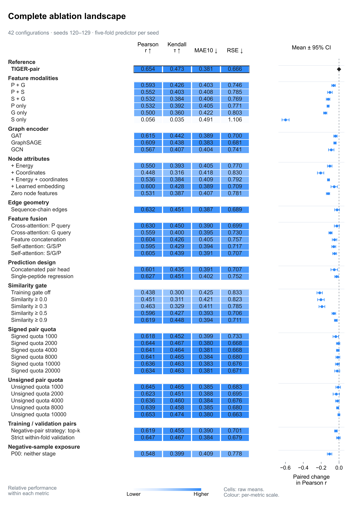

# TIGER: Therapeutic-Index-Guided Exploration and Refinement

[](https://github.com/haifangong/TIGER/actions/workflows/v17.yml)

TIGER supports antimicrobial peptide design by combining activity modelling, toxicity filtering and sequence refinement. This repository releases the **V17 TIGER-pair model**, its actual training inputs, ten-seed checkpoints and complete ablation results for *E. coli* MIC differences. The current AMP classification module supports activity screening; existing toxicity and multi-species wet-lab workflows retain their matching implementations.

**Current reference:** P11, **unsigned pair quota 20,000**, training similarity gate 0.7, neighbour validation, seeds **120–129**, five folds per seed. Strict within-fold validation is a separate ablation.

[Model methods](docs/METHODS_V17.md) · [Complete ablation table](docs/ABLATION_RESULTS.md) · [Migration notes](docs/MIGRATION_V17.md) · [23-method benchmark](https://github.com/YueWang-Lambda/TIGER_AMP_Benchmarking)

## AMP activity classification

The current [15-method E. coli AMP classification module](amp_classification/README.md) replaces the original AMP classifier and toy comparison. It predicts **MIC <128 µg/mL** and includes five-seed results, fixed training/validation/Test200 splits, all 15 seed123 checkpoints, training and inference code, numerical replay, and publication figures. [Pipeline Step 1](pipeline/01_mutation_search/README.md) now uses the calibrated CatBoost-Tuned classifier and full 6–50-residue input.

```bash
python -m pip install -r amp_classification/requirements-replay.txt
python -m amp_classification verify
python -m amp_classification replay
```

The AMP endpoint and random Test200 are distinct from the family-based ΔMIC evaluation below. See the [AMP results and validation design](amp_classification/README.md#test-results).

## Results and endpoint

The external panel contains **208 peptides, 11 families and 2,211 unique directed within-family pairs**. Each prediction targets `ΔMIC = log2(MIC_anchor / MIC_query)`, with MIC in µg/mL. A positive prediction means the query peptide is more potent.

Metrics are calculated within each family, then averaged with equal family weights. Values below are **mean ± sample SD across ten seeds**. For each seed, five fold predictions are averaged and the saved out-of-fold linear calibrator is applied once.

| Model | Family-macro PCC ↑ | Family-macro Kendall τb ↑ | Family-macro log10MAE ↓ | Family-macro RSE ↓ |
| :--- | ---: | ---: | ---: | ---: |
| **TIGER-pair (V17)** | **0.6543 ± 0.0168** | **0.4729 ± 0.0210** | **0.3813 ± 0.0077** | **0.6659 ± 0.0256** |

Unrounded results: [`results/v17/reference/tiger_summary.csv`](results/v17/reference/tiger_summary.csv). The landscape contains **42 configurations × 10 seeds = 420 prediction files**. The 41 controls × four metrics share one Holm correction over 164 two-sided paired-seed Wilcoxon tests; none meets adjusted *P* < 0.05. The main model was selected using this external panel, so these comparisons are exploratory. Seed SD quantifies training variability on a fixed panel.



## Repository contents

| Path | Contents |
| :--- | :--- |
| [`amp_classification/`](amp_classification/) | Current 15-method MIC128 classifier benchmark, data, checkpoints, code and figures |
| [`code/`](code/) | Frozen numerical core and portable V17 train/predict entrypoints |
| [`configs/TIGER_pair/`](configs/TIGER_pair/) | Ten main-model configurations with relative paths |
| [`configs/ablation/`](configs/ablation/) | All 420 arm–seed configurations; scientific fields unchanged |
| [`checkpoints/V17/TIGER_pair/`](checkpoints/V17/TIGER_pair/) | 50 selected fold checkpoints, 100 scaling files, ten calibrators, fold identities and pair audits |
| [`data/v17/`](data/v17/) | Frozen activity/negative tables, canonical endpoint, descriptors and exact structures |
| [`results/v17/`](results/v17/) | Per-pair predictions, family/seed metrics, summaries and paired tests |
| [`scripts/`](scripts/) | Structure preparation, numerical replay, input auditing, plotting and verification |
| [`notebooks/V17_reproduction.ipynb`](notebooks/V17_reproduction.ipynb) | Executed CPU-only result and figure reproduction |
| [`provenance/`](provenance/) | Source/checksum records, configuration identities and validation evidence |
| [`docs/`](docs/) | Methods, complete ablation table and migration notes |
| [`pipeline/`](pipeline/) | Existing design workflow; Step 4 uses the matching pre-V17 runtime |
| [`legacy/`](legacy/) | Original implementation and README for historical compatibility |

## Installation

Use Python **3.10**; the [recorded training environment](provenance/training_environment.json) gives package versions. Run these commands from the repository root:

```bash
GIT_LFS_SKIP_SMUDGE=1 git clone https://github.com/haifangong/TIGER.git
cd TIGER
python -m venv .venv
source .venv/bin/activate
python -m pip install --upgrade pip
python -m pip install -r requirements-analysis.txt
```

V17 data, weights and structure archives use ordinary Git objects and require no LFS download. Historical discovery data still include an LFS archive; see [`legacy/README.md`](legacy/README.md).

For model inference or training:

```bash
python -m pip install torch==2.2.0 --index-url https://download.pytorch.org/whl/cu121
python -m pip install -r requirements-model.txt
```

Use the official PyTorch build appropriate to your hardware. For CPU inference, replace the index URL with `https://download.pytorch.org/whl/cpu`. The frozen implementation uses PyTorch 2.2.0 and PyTorch Geometric 2.5.3; newer versions are not assumed to reproduce its numerics or loading behaviour.

## 1. Reproduce results without a GPU

```bash
python scripts/verify_release.py
python -m unittest discover -s tests -v
python scripts/reproduce_v17.py
python scripts/plot_v17.py
```

Replay aligns every prediction by **family, anchor sequence and query sequence**, verifies its checksum and MIC-to-log2 labels, and independently recomputes four metrics, seed summaries, confidence intervals and all 164 paired tests. Outputs go to `outputs/replay/` and `outputs/figures/`; reference results are protected from overwriting. Original publication figures are retained under [`figures/v17/`](figures/v17/).

```bash
python -m pip install -r requirements-notebook.txt
jupyter lab notebooks/V17_reproduction.ipynb
```

## 2. Predict with released checkpoints

The following uses seed 123's five fold checkpoints and the bundled external structures. It applies each fold's own descriptor/node scales, averages raw predictions, then applies the saved calibrator once.

```bash
python -m code.main predict --seed 123 --device cpu \
  --output outputs/seed123 --check-reference

python -m code.main predict --seed 120 --device cuda:0 \
  --output outputs/seed120 --check-reference
```

Seeds 120–129 are available. The ten-seed mean in the table is not the metric of one seed or a prediction averaged across all ten seeds. CPU/GPU replay allows `2e-5` absolute error per calibrated log2 prediction; frozen predictions define exact paper tables.

For new peptides, supply a peptide table, directed pair table and Rosetta-compatible `{SEQUENCE}.pdb` structures:

```bash
python -m code.main predict --seed 123 --device cuda:0 \
  --peptides /path/to/peptides.csv --pairs /path/to/pairs.csv \
  --pdb-dir /path/to/pdb --output outputs/custom
```

Peptide columns: `sequence`, optional `n_terminus`, `c_terminus`, `cfu_group`, and optionally `MIC_E_coli_ug_mL` for evaluation. Pair columns: `anchor_sequence`, `query_sequence`, optional `family`. Unique peptide sequences must exactly cover the pair endpoints. Default CFU input is `1E5 - 1E6`; custom tables may supply another category. See the [input conventions](docs/METHODS_V17.md). Predictions are differences; absolute MIC estimation requires an anchor with known MIC.

## 3. Train the current model

```bash
# Extract and SHA256-check the exact training structures.
python scripts/prepare_structures.py

# Rebuild graphs and reproduce seed123/fold1 positive and negative pair hashes.
python scripts/check_training_inputs.py

# Full five-fold training; output must be a new/empty directory.
python -m code.main train --config configs/TIGER_pair/seed123.json \
  --device cuda:0 --out-dir outputs/training/seed123

python -m code.main predict --run outputs/training/seed123 --device cuda:0 \
  --output outputs/training_evaluation/seed123
```

The frozen activity table has 11,516 source rows. Of these, **7,530 records have valid E. coli MIC**. Removing 129 length-ineligible records and 184 sequence–CFU duplicates leaves **7,217 usable rows representing 6,847 unique sequences**; all retained rows construct graphs successfully. The recorded first fold contains 5,773 training rows and 1,444 validation rows. These row counts are not distinct-peptide counts. The separate 7,860-peptide negative pool does not enter validation or calibration; activity records take precedence on exact sequence conflicts.

All controls use the same command with `configs/ablation/<arm>/seed<seed>.json`. Main-model and single-head results reuse complete earlier ten-seed batches; 40 other controls were retrained for V17. Newly distributed weights cover the main model; configurations and predictions cover every control. Formal training uses the original dataflow. Fresh stochastic training may vary numerically; the supplied checkpoints and archived predictions define this release.

## Architecture and protocol

TIGER-pair combines **P** (ten global descriptors), **S** (integer sequence tokens) and **G** (Cα contact graph with GATv2). The graph enables 20 amino-acid prior channels and masks the 20 stored energy channels. Sequence-query cross-attention fuses modalities; a difference head predicts signed log2-MIC changes.

Five-fold CV groups exact sequences. Positive-pair candidates use a ±5-residue window, a directed alignment-score threshold of 0.7, and unsigned bins `int(round(abs(delta) * 100))` capped at 20,000 pairs per bin, with a total 250,000 cap. The target remains signed. Neighbour validation uses top-50/fallback-20. Classification pretraining runs for 15 epochs; regression runs for at most 70 with patience 16. Checkpoint selection and OOF calibration are model-selection-aware, not a nested outer test. Full definitions are in [`docs/METHODS_V17.md`](docs/METHODS_V17.md).

## Benchmarks and historical workflows

The complete 23-method benchmark, negative-sample controls, TIGER-single, TIGER-ensemble, timings and Pareto analyses are in [TIGER_AMP_Benchmarking](https://github.com/YueWang-Lambda/TIGER_AMP_Benchmarking). This repository supplies the current TIGER-pair model, complete ablation landscape, and the separate [15-method AMP classification benchmark](amp_classification/README.md).

Historical toxicity and multi-species weights remain in `checkpoints/ablation_toxin/` and `checkpoints/wetlab/`; they were not retrained in this update. Pipeline Step 4 imports `legacy/runtime/` to retain its `gsh`/`global_f` architecture alongside V17's `gps`/`p_f` implementation. Old MIC ablation weights/tables have been replaced on the default branch. The previous release remains available at [commit b83b41c](https://github.com/haifangong/TIGER/tree/b83b41c17a757722c4a49648359fdbc6c0f68ef6).

## Citation

Please cite the corresponding TIGER study, **Deep learning decouples antimicrobial peptide efficacy from host toxicity**, and the original data sources recorded in the external peptide table. Source attribution and previously distributed discovery assets are retained.
